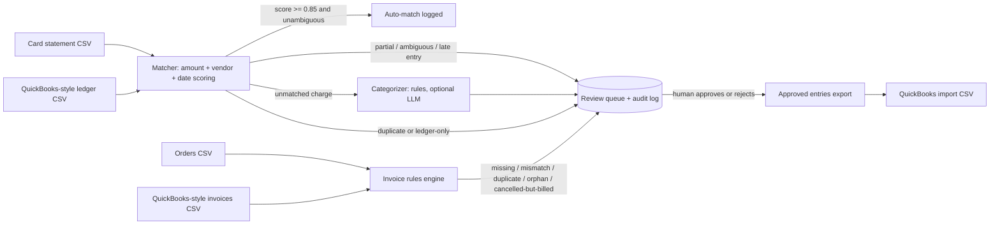
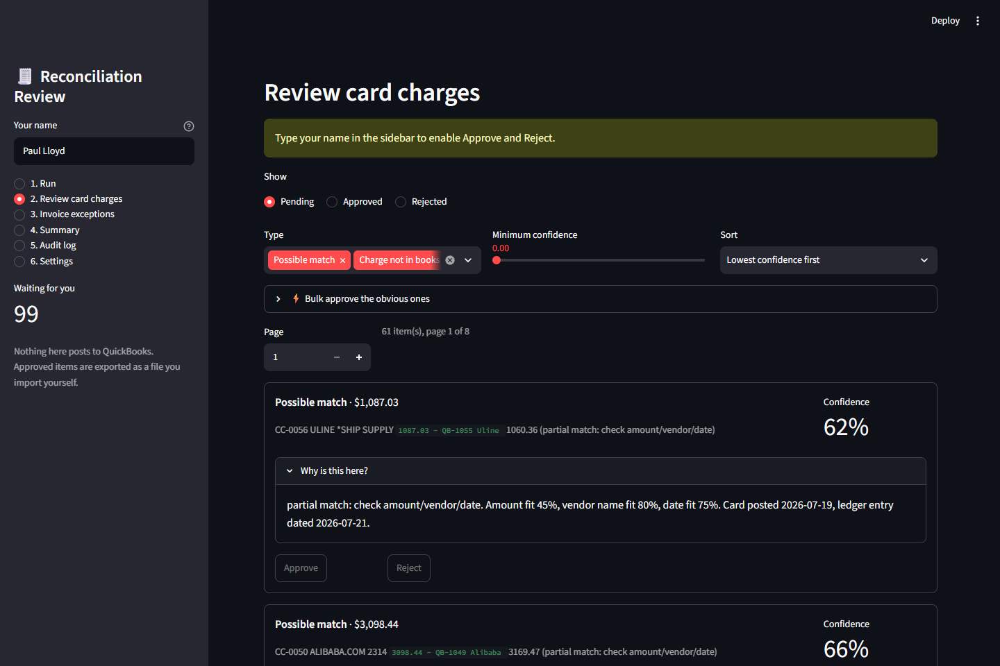
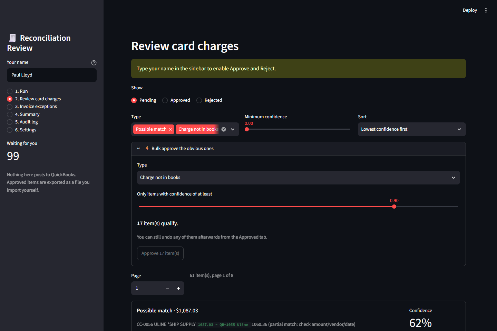
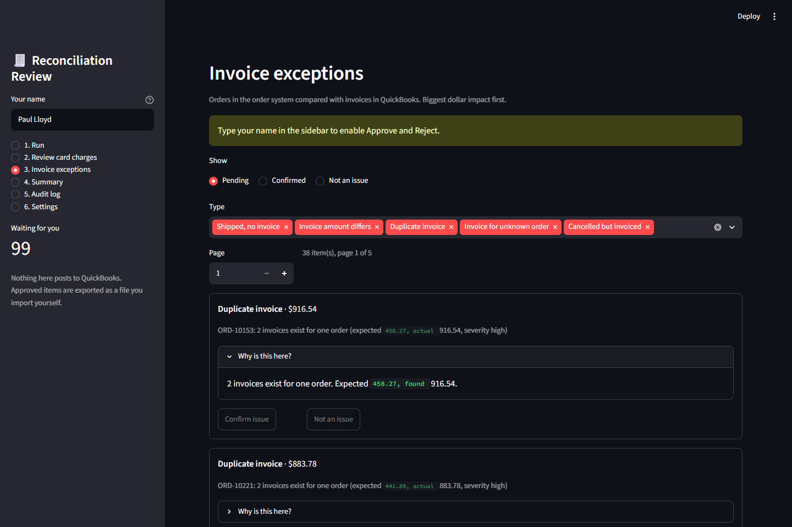
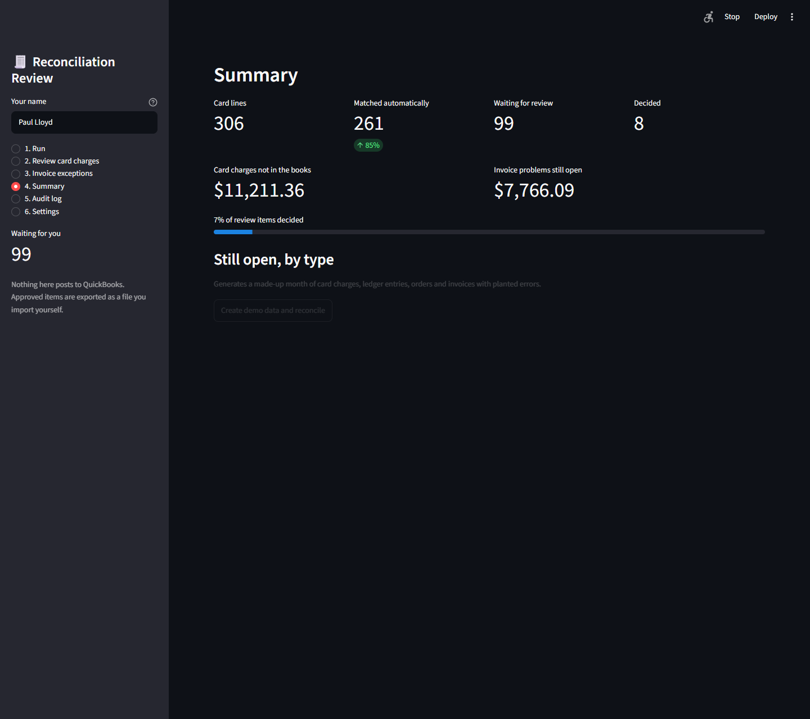
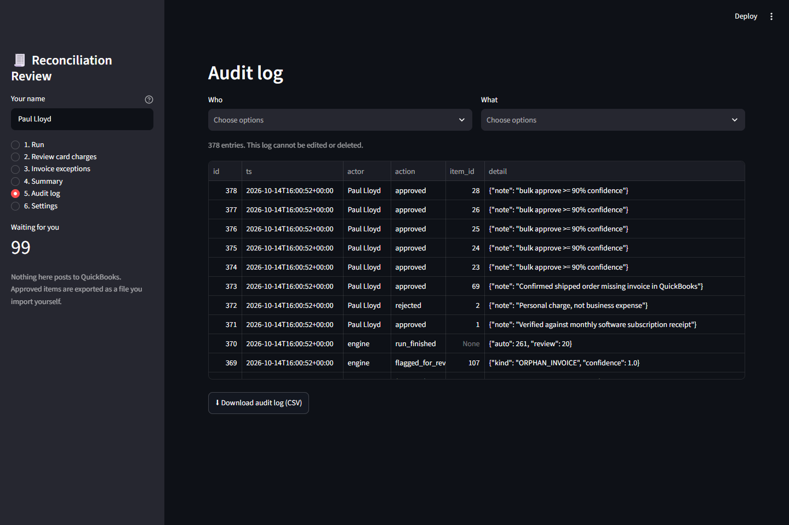
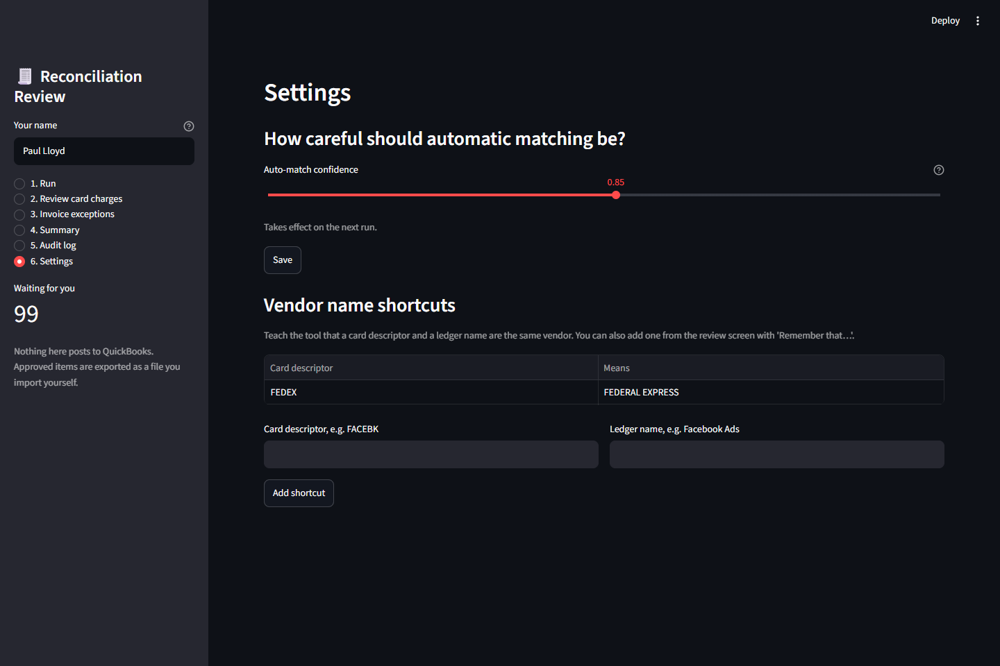

# Reconciliation Engine: card statements and invoices vs the books

A small, runnable project that automates two finance-ops chores found in most e-commerce back offices:
**(1)** matching credit-card charges to bookkeeping entries, and **(2)** reconciling the order-management
system against accounting invoices. Everything an AI or rule proposes goes through a **human approval queue
with an append-only audit log**. Nothing is ever posted automatically.

## Problem

Month-end card reconciliation is slow and error-prone. Merchant descriptors are cryptic
(`AMZN MKTP US*2K4LM`), entries get keyed twice, amounts drift by fx fees or tips, and some charges are
never recorded. Separately, shipped orders go uninvoiced, invoices get duplicated, and cancelled orders still
get billed. A person eyeballs spreadsheets to find these. This project finds them in seconds, ranks them,
and leaves the judgment calls to a person.

## Architecture

## What's in this repo

| Path | What it does |
|---|---|
| `src/generate_data.py` | Builds messy synthetic data plus a hidden answer key of planted defects |
| `src/matcher.py` | One-to-one scoring (amount 50%, vendor 30%, date 20%), ambiguity guard, duplicate detection, late-entry second pass |
| `src/invoice_recon.py` | Five explainable rules: missing, mismatched, duplicate, orphan, and cancelled-but-invoiced |
| `src/categorize.py` | Rule-based category proposals with confidence; optional LLM fallback for low-confidence rows |
| `src/store.py` | SQLite review queue, decisions, edits, undo, and an append-only audit log enforced by triggers |
| `src/service.py` | Application layer for the UI: upload validation, bulk actions, summary, settings, vendor-alias learning, export |
| `app.py` | **Streamlit review screen for non-technical staff** (see below) |
| `src/cli.py` | `demo`, `review`, `decide`, `export`, `audit` commands and the scored report |
| `tests/test_engine.py` | 10 engine tests, including an end-to-end quality floor |
| `tests/test_app.py` | 6 tests that drive the real Streamlit app headlessly (approve, edit, undo, bulk approve, validation) |
| `reports/summary.md`, `exceptions.csv` | Latest run output |
| `docs/setup.md` | Run it, plus where to capture screenshots and what to say in the video |

## Results on the demo data (seed 42)

306 card lines, 25 unrecorded charges worth about $11.2k, and 38 invoice problems.

| Check | Precision | Recall |
|---|---|---|
| Auto-matches correct | 100% | 98.9% (auto + review) |
| Unrecorded charges found | 88% | 100% |
| Duplicate entries | 100% | 100% |
| Invoice findings (5 types) | 100% | 100% |

- **85% of card lines match with no human touch**; 20 go to review; the rest are exceptions.
- The 88% precision on unrecorded charges is deliberate noise showing up: a few entries keyed more than a
  week late or under a very different vendor name look "missing" until a person links them.
- Category proposals were right on every row with confidence of 0.90 or higher, and those make up 88% of
  proposals. Low-confidence rows (an unclear `PAYPAL *` payee, a vague "supply" merchant) are routed to a person.

**These come from generated data with planted defects. They show the engine behaves as designed. They are not
a claim about real company books.**

## The review app (built for people who don't use a terminal)

Run it with `pip install -r requirements.txt` then `streamlit run app.py`.

| Screen | What a non-technical user does there |
|---|---|
| **1. Run** | Try demo data or upload the four CSVs. Files are checked first, with plain-English errors and downloadable templates |
| **2. Review card charges** | Works through a queue of cards: approve, reject, or fix the suggested category. Every card has a "Why is this here?" explanation. Bulk-approve everything above a confidence level, and undo any decision |
| **3. Invoice exceptions** | Same flow for missing, mismatched, duplicate, orphan and cancelled-but-billed invoices, biggest dollar impact first |
| **4. Summary** | Match rate, dollars still open, progress, and a time-saved estimate |
| **5. Audit log** | Who did what and when, filterable and downloadable |
| **6. Settings** | Auto-match strictness and vendor-name shortcuts, no code needed |

Adoption details that matter more than the screens: a name is required before anyone can approve; "Remember that
FEDEX means Federal Express" teaches the matcher from a reviewer's own approval; approved entries leave as a CSV
file for QuickBooks import, so the app never posts to the books; and every click is audited.

### Visual Walkthrough

#### 1. Review Queue & Explainable AI Matching
Every candidate match displays a confidence score, category suggestion, and a plain-English "Why is this here?" breakdown (amount fit, vendor match, date delta) before any human approval.

#### 2. High-Confidence Bulk Approval
Reviewers can quickly clear high-confidence items (e.g. >= 90% confidence) in one click while retaining full undo capability.

#### 3. Invoice Exceptions (Order System vs QuickBooks)
Highlights missing, duplicated, mismatched, or cancelled invoices, prioritized by largest dollar impact first.

#### 4. Summary & Operational Metrics
Tracks auto-match rates, unresolved dollars, and estimated staff hours saved.

#### 5. Immutable Audit Trail
Every single automated action, reviewer decision, category change, and undo is recorded in an append-only audit log enforced by SQLite database triggers.

#### 6. Settings & Vendor Alias Learning
Staff can adjust the auto-match confidence threshold and teach the engine vendor shortcuts (e.g., `FEDEX` means `Federal Express`) without editing code.

## Design decisions worth discussing

- **Wrong auto-matches are the costly error**, so the tests guard auto-match precision hardest (floor: 98%),
  and ambiguous top candidates are downgraded to review even when the score is high.
- **Human-in-the-loop by construction**: decisions stay put unless a person explicitly undoes them (and the undo is itself
  logged), audit rows can't be edited or deleted
  (database triggers), and export only writes what a reviewer approved.
- **Rules before LLM**: deterministic rules handle the obvious rows cheaply and auditably. The optional LLM
  pass only sees low-confidence rows, its answer is validated against the allowed categories, its confidence
  is capped, and it still can't post anything.
- **Late entries are never auto-approved**: widening the date window raises the risk of false matches.

## Limitations and next steps

- Vendor aliases are a hand-built map (`FEDEX` vs "Federal Express" lands in review). Next step: learn aliases
  from approved matches.
- Refunds, split transactions, and multi-currency are not modeled.
- Invoice rules use exact order references. Real data often needs fuzzy keys.
- Connecting to real QuickBooks and order-system APIs is out of scope here. The app takes CSV uploads that must match the
  four templates; real exports will need a column-mapping step.
- The app identifies reviewers by a typed name, not a login. A real rollout needs single sign-on and per-role access.
- SQLite is fine for one reviewer at a time; several simultaneous users would need Postgres.
- The 'time saved' figure on the Summary page uses a minutes-per-line number the user types in. It is an assumption,
  not a measurement.

## Tech stack

Python 3.12 (engine uses the standard library only), **Streamlit** (review UI), SQLite, pytest (including Streamlit's
headless `AppTest`), GitHub Actions. Optional: the Anthropic Messages API for
low-confidence categorization.

## Honesty note

This is built on **synthetic CSVs that mimic QuickBooks and SellerCloud-style exports**. It is not connected to
either product, and I have not run it against production data. The optional LLM categorization path is written
and input-validated but was **not exercised against the live API** for the numbers above, which use rules only.
