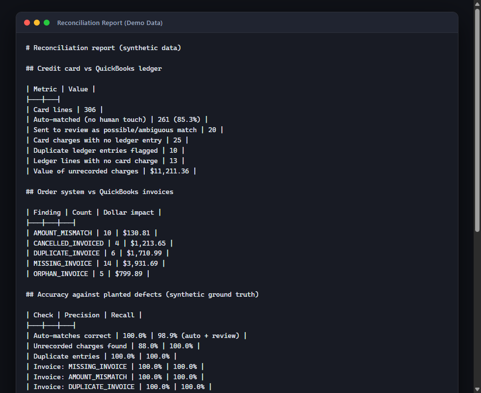
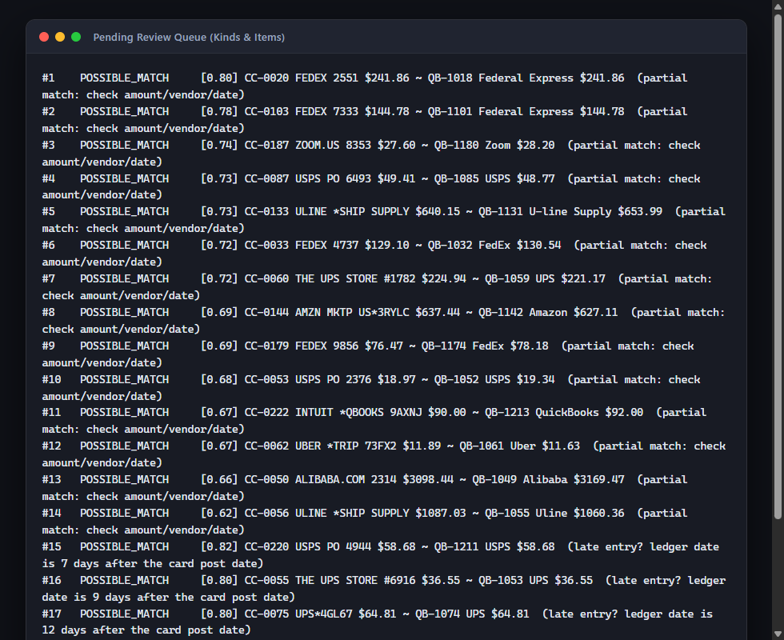
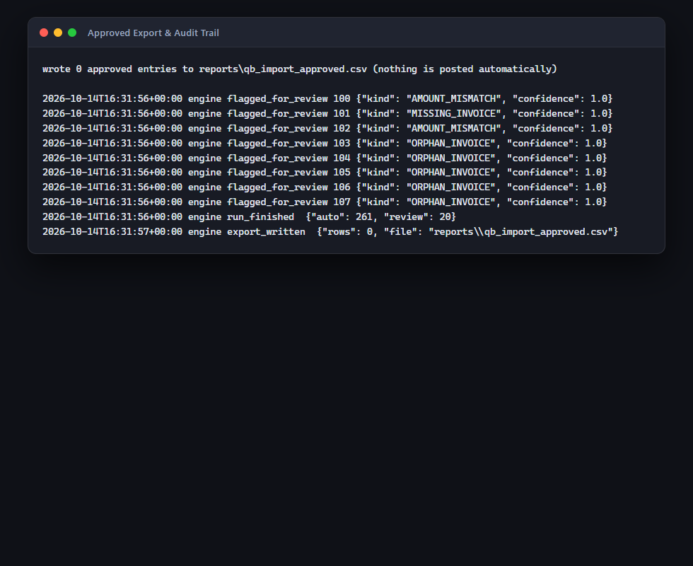
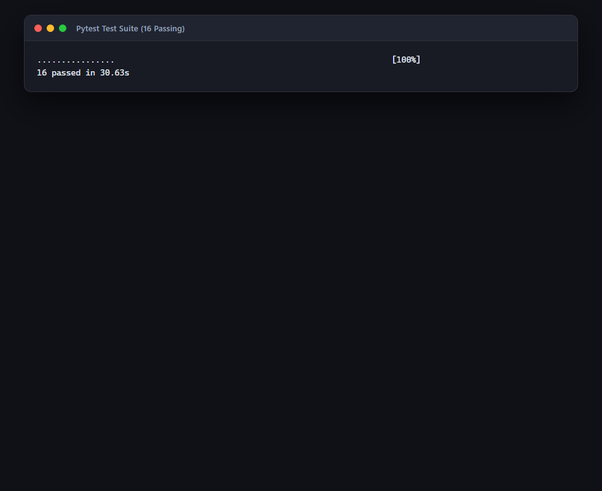

# Setup and demo checklist

## 1. Run it (5 minutes, no installs needed beyond Python 3.10+)

1. `git clone https://github.com/paulloyd/recon-engine.git` and `cd recon-engine`
2. `python -m src.cli demo` - generates data, reconciles, prints the report, writes `reports/summary.md`
   - **Screenshot 1:** the terminal summary tables.
   
   

3. `python -m src.cli review` - lists pending items.
   - **Screenshot 2:** the queue showing different kinds (POSSIBLE_MATCH, MISSING_ENTRY, DUPLICATE_ENTRY, invoice findings).
   
   

4. `python -m src.cli review --kind MISSING_ENTRY` then `python -m src.cli decide <ID> approve --reviewer "Paul Lloyd" --note "checked receipt"`
5. `python -m src.cli decide <ID> reject --reviewer "Paul Lloyd" --note "personal charge, not business"` on another item
6. `python -m src.cli export` - writes `reports/qb_import_approved.csv` with only approved rows
   - **Screenshot 3:** the export file next to the audit trail.
   
   

7. `python -m src.cli audit` - every engine action and human decision, timestamped
8. `pip install -r requirements-dev.txt && python -m pytest -q` - **Screenshot 4:** 16 passing tests

   

## 1b. Run the review app (the screen to record for the video)

1. `pip install -r requirements.txt` then `streamlit run app.py` (from the repo root)
2. Type your name in the sidebar. Approve and Reject stay disabled until you do.
3. **1. Run** -> "Create demo data and reconcile"
4. **2. Review card charges** -> expand "Why is this here?" on one card, change a category, approve it; reject another;
   use **Bulk approve** at 90% confidence; then undo one from the Approved view.
   - **Screenshot A:** the review queue with a card expanded.
   
   

   - **Screenshot B:** the bulk-approve panel.
   
   

5. **3. Invoice exceptions** -> confirm one issue.
   
   

6. **4. Summary** -> **Screenshot C**, and try your own minutes-per-line number.
   
   

7. **5. Audit log** -> **Screenshot D:** shows approved, edited, reopened, bulk approvals.
   
   

8. Approved view -> "Download approved entries" gives the QuickBooks import file.

## 2. Optional LLM categorization

`export ANTHROPIC_API_KEY=...` then `python -m src.cli demo --llm`. Only low-confidence rows are sent
(merchant descriptor and amount, nothing else). Say honestly in the video if you did or did not try this.

## 3. Push to GitHub

Create a repo, push, and confirm the Actions tab shows the tests passing. Pin the repo on your profile.

## 4. Video moments (about 2 minutes for this project; screen-record the app, not the terminal)

1. **Problem (10s):** "Month-end card reconciliation is slow; here's a messy statement and ledger."
2. **Run (20s):** `demo`, point at 85% auto-matched and the dollar value of unrecorded charges.
3. **Judgment (45s):** in the app, open a card, read 'Why is this here?', fix a category, approve one, reject one, bulk-approve the obvious ones, undo one.
4. **Control (15s):** show the Audit log tab and say that it can't be edited and nothing posts to QuickBooks without a person.
4b. **Adoption (15s):** 'A name is required before approving, and the tool learns vendor names from reviewers.'
5. **Honesty (15s):** "Synthetic data, rule-based first, LLM only for low-confidence rows, and here's what
   I'd change with real QuickBooks access."

## 5. Questions to rehearse

- Why prioritize auto-match precision over recall? (A wrong auto-match hides an error; a review item costs a minute.)
- How would you connect this to real QuickBooks? (Export or API read, a staging account, read-only first, then approved-entry import.)
- What breaks on real data? (Vendor aliases, refunds, splits, currency, late entries. Say what you'd measure first.)
- How would you roll this out to a team? (Pilot with one reviewer for a month, track time saved and false-match rate, then expand.)
